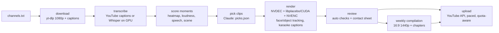

# yt-clipper

[](https://github.com/nileshvermaa/yt-clipper/actions/workflows/ci.yml)


GPU-first pipeline that turns long YouTube videos into captioned, auto-reframed vertical **Shorts** and a weekly
16:9 **compilation**, then uploads them through the YouTube Data API. Built to run unattended on a desktop PC
with the CPU kept almost idle, and to work **without an LLM API key**: clip selection can be done by Claude in
the Claude desktop app (scheduled task) or, optionally, through the Anthropic API.

## How it works



| Stage | What it uses |
|---|---|
| Download | `yt-dlp` (cached by video id; hi-res streams fetched only for the clip's seconds) |
| Transcript | YouTube captions first; `faster-whisper large-v3` on CUDA as fallback; garbled/wrong-language detection |
| Moment scoring | "Most Replayed" heatmap + loudness + speech rate + scene changes, no API cost |
| Reframing | YuNet faces, YOLOX objects, EMA-smoothed pan, facecam "reaction" layout |
| Render | FFmpeg: NVDEC/Vulkan decode, libplacebo or CUDA scale, NVENC encode, libass captions |
| Quality gate | silent audio, overlaps, 6-frame contact sheet reviewed before upload |
| Upload | YouTube Data API v3 resumable upload, daily quota guard, pacing, Private by default |

## Quick start (Windows + NVIDIA GPU)

```powershell
git clone https://github.com/nileshvermaa/yt-clipper.git
cd yt-clipper
python -m venv .venv
.venv\Scripts\pip install -r requirements.txt
.venv\Scripts\python scripts\download_models.py
copy .env.example .env
copy channels.example.txt channels.txt
winget install Gyan.FFmpeg
.venv\Scripts\python -m clipper auth          # one-time YouTube login, see SETUP.md
```

Full setup (Google Cloud OAuth, consent screen, scheduled task, tuning): **[SETUP.md](SETUP.md)**.

## Commands

| Command | Purpose |
|---|---|
| `python -m clipper prepare [url ...]` | download + transcribe, write `candidates.txt` (no API key) |
| `python -m clipper awaiting` | list videos that still need `picks.json` |
| `python -m clipper finish` | render picked clips, run checks, make contact sheets |
| `python -m clipper review` / `approve` / `reject` | quality gate before upload |
| `python -m clipper upload-pending` | upload approved clips (paced, quota-aware) |
| `python -m clipper compile [--approve DATE] [--upload]` | weekly 16:9 compilation |
| `python -m clipper explain script.json [--upload --pick N]` | narrated, branded explainer video (Kokoro voice) |
| `python -m clipper versus --a URL S E --b URL S E` | "GTA V vs GTA VI" back-to-back Short |
| `python -m clipper run <url>` | one-shot with the Anthropic API (needs `ANTHROPIC_API_KEY`) |
| `python -m clipper status` | clips per video and today's upload count |

Only one pipeline run can execute at a time (OS file lock); stuck videos are killed after 60 minutes.

## Configuration

All settings live in `.env` (see [`.env.example`](.env.example)): clip length, frames/fps, GPU filters,
CPU thread cap, review gate, upload pacing, privacy, channel language. Channels to watch go in
`channels.txt`, one per line, optionally filtered by title keywords: `URL | gta 6, gta vi`.

## Project layout

```
clipper/            pipeline package (python -m clipper)
  download.py       yt-dlp fetch, captions, stream URLs
  transcribe.py     captions/Whisper, quality + language checks
  signals.py        free moment scoring
  select_clips.py   candidates.txt / picks.json / Anthropic API
  reframe.py        sampling, face/facecam tracking, crop path
  subject.py        YOLOX object detection
  render.py         FFmpeg render ladder (vulkan -> gpu -> cpu)
  captions.py       ASS karaoke captions
  review.py         checks, contact sheets, per-video log
  compile.py        weekly 16:9 compilation
  versus.py         side-by-side comparison Shorts
  upload.py         YouTube OAuth + resumable upload
scripts/            model download
tests/              fast unit tests (no GPU/network)
docs/site/          homepage, privacy and terms pages for the Google OAuth consent screen
```

## Development

```powershell
pip install ruff pytest
ruff check .
pytest -q
```

CI runs lint and tests on every push (GPU stages are not exercised in CI).

## Responsible use

This tool processes other creators' videos. Only clip channels that allow it or that you have permission from,
keep the on-screen and description credit, and prefer adding your own commentary. Re-used content can be
claimed via Content ID and may not be monetizable. Uploads default to **Private** for that reason.

## License

[MIT](LICENSE)
